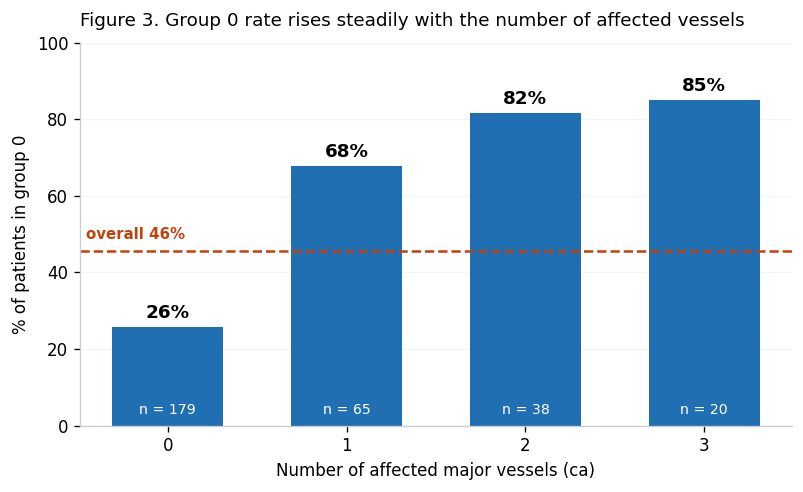
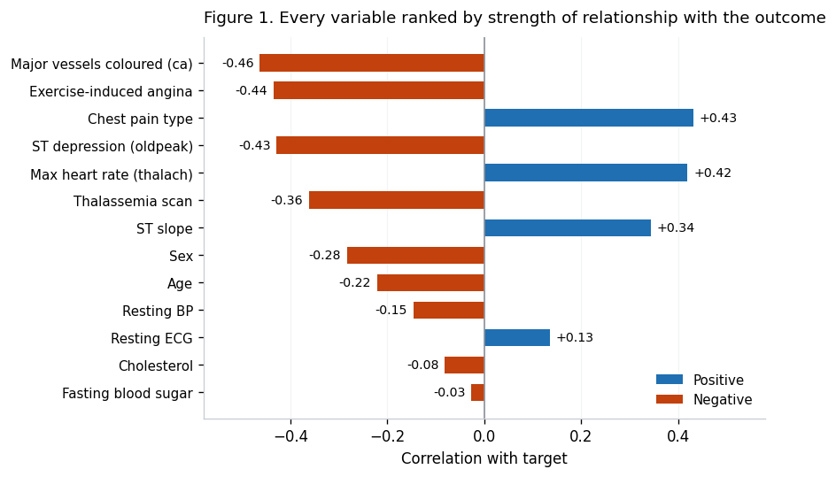
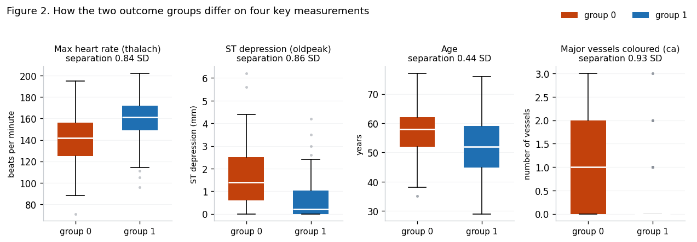
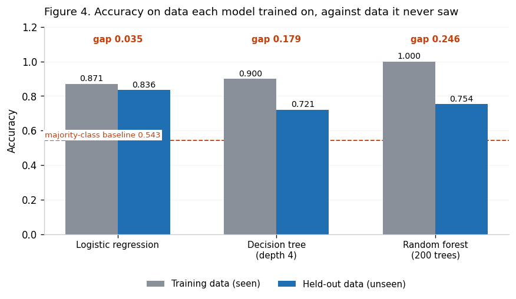
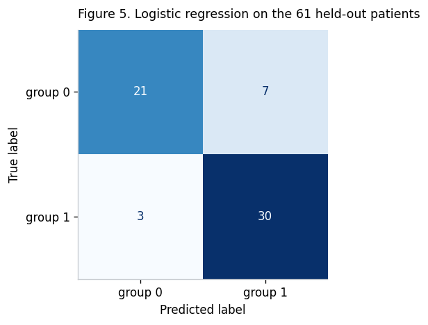
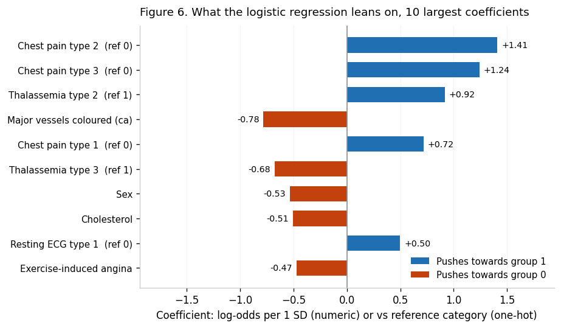
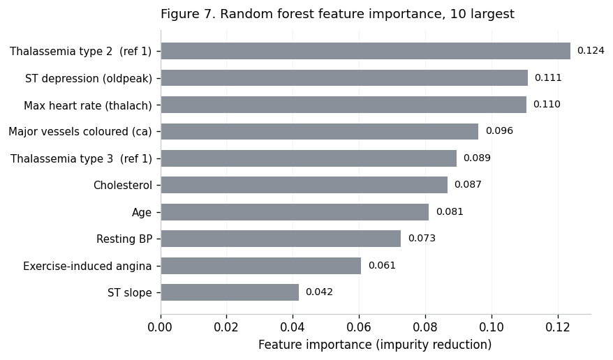

# Can routine measurements screen for heart disease?

Predicting heart-disease status from routinely collected clinical measurements, and testing how much predictive signal survives when the two measurements that require a catheter or a nuclear scan are taken away.

**Python, scikit-learn.** 302 patients, 13 measurements, three classifiers compared.



*The clearest single pattern in the data. As the number of affected major vessels rises from
0 to 3, the share of patients in the clinically-affected group climbs from 26% to 85%,
against an overall rate of 46%. This is also the measurement that requires an invasive
procedure to obtain, which is exactly what makes the screening question worth asking.*

---

## The question

A primary care clinic has to decide which patients to refer for further cardiac testing, and
has to decide it **before** an angiogram result exists. Angiography is expensive and
invasive, so a model that relies on it cannot help with that referral decision.

> Can routinely available patient characteristics predict heart-disease status well enough to
> be useful as an early screening tool, and which measurements carry that signal?

That takes two parts to answer: whether a model can predict at all, and whether it can still
predict once the expensive inputs are removed.

## The data

The Cleveland subset of the UCI Heart Disease dataset. 303 patient records, 13 clinical
measurements, one binary outcome. After removing one exact duplicate row, 302 patients.

Two columns carry codes outside their documented ranges. These are instrument failures
recorded as numbers rather than real categories, so they are treated as missing and imputed
rather than dropped, which would have discarded six complete patient records:

| Column | Documented range | Bad code | Rows |
|---|---|---|---|
| `ca` (major vessels) | 0 to 3 | `4` | 4 |
| `thal` (thallium scan) | 1 to 3 | `0` | 2 |

### The outcome label is inverted

The `target` column's direction is **reversed relative to UCI's original `num`**, which means
most published descriptions of this redistribution have the clinical direction backwards. Two
independent lines of evidence settle it.

Every clinical indicator points the same way:

| Indicator | Group 0 | Group 1 | Direction |
|---|---|---|---|
| Mean age | 56.6 | 52.6 | Group 0 older |
| Max heart rate achieved | 139.1 | 158.4 | Group 0 lower |
| Exercise-induced angina | 55.1% | 14.0% | Group 0 nearly 4x |
| ST depression | 1.59 | 0.59 | Group 0 higher |
| Affected vessels | 1.15 | 0.27 | Group 0 over 4x |
| Proportion male | 82.6% | 56.1% | Group 0 more male |

And the counts agree: after deduplication **group 1 holds exactly 164 patients, which is
UCI's documented count for `num = 0`, disease absent**.

So `target = 1` means disease **absent**, and group 0 is the clinically affected group. The
notebook uses neutral "group 0" and "group 1" labels throughout, so no magnitude or ranking
in it depends on this. Only the clinical direction does.

## What the data shows



Affected vessel count has the strongest single relationship with the outcome at -0.46, and it
is one of the two measurements needing an invasive procedure. Exercise-induced angina follows
at -0.44, then chest pain type at +0.43, ST depression at -0.43 and maximum heart rate at
+0.42. **Only 2 of the 13 measurements require a catheter or a nuclear scan, and the cheap
ones sit immediately behind them in strength.** That is the observation the whole project
rests on.



Gaps between group means are expressed in standard deviations so variables measured in
different units can be compared directly. Affected vessel count separates the groups by 0.93
standard deviations, ST depression by 0.86, maximum heart rate by 0.84 and age by 0.44.

## Results

All numbers below were reproduced from scratch before being written here. Seed is 42
throughout. 302 patients, split 241 train and 61 held out, stratified.

A model that ignored every measurement and always guessed the larger class would score
**0.543**. That is the floor every number here should be read against.

| Model | Train | 5-fold CV | Held out | ROC AUC |
|---|---|---|---|---|
| Logistic regression | 0.871 | **0.847** ± 0.050 | **0.836** | **0.895** |
| Decision tree (depth 4) | 0.900 | 0.776 | 0.721 | 0.744 |
| Random forest (200 trees) | 1.000 | 0.822 | 0.754 | 0.894 |



The random forest scores a perfect 1.000 on data it trained on and 0.754 on data it did not.
That 25-point gap is textbook overfitting, and it is the reason three models were fitted at
deliberately different flexibility rather than one. A single model tells you nothing about
whether it is memorising. Logistic regression generalises best and is carried forward.

### The central result: removing the expensive measurements

`ca` (major vessels, needs a catheter) and `thal` (thallium stress test, needs a nuclear scan)
removed, individually and together:

| Removed | 5-fold CV | Held out |
|---|---|---|
| Nothing | 0.847 | 0.836 |
| `ca` only | 0.817 | 0.738 |
| `thal` only | 0.805 | 0.836 |
| **Both (routine-only model)** | **0.776** | **0.787** |

The routine-only model gives up about 7 accuracy points. Measured against the 0.543 baseline
it **retains 76.8% of the predictive skill the full model had above that floor**, which is the
comparison that means something: `(0.776 - 0.543) / (0.847 - 0.543)`. It is not a claim that
the model is 76.8% accurate.

### The errors that actually matter

A screening tool is judged on the patients it misses, and it has to be judged on the errors of
the model that would actually be deployed, not the full model's.



| Model | Held out | Affected-group recall | Affected cases missed |
|---|---|---|---|
| Full (all 13 measurements) | 0.836 | 0.750 | 7 of 28 (25%) |
| Routine-only | 0.787 | 0.786 | 6 of 28 (21%) |

The routine-only model does **not** miss more affected patients than the full model, despite
scoring lower overall. With only 28 affected patients held out the difference is a single
person and well inside noise, so the honest reading is "no worse", not "better". What it rules
out is the assumption that dropping the invasive inputs must cost you sensitivity.

Missing roughly one affected patient in five is still too high for a tool used on its own. The
conclusion is referral triage alongside a clinician, not autonomous screening.

## What the model leans on





**Magnitude, sign and importance are three different things.** Logistic regression gives signed
coefficients, so it says which direction each measurement pushes. Random forest importance has
no sign at all, only magnitude, and it divides a one-hot variable's importance across its dummy
columns. The two rankings answer different questions and are not expected to agree column for
column.

Coefficients are also not all in the same unit. Numeric columns were standardised, so their
coefficients are the change in log-odds for a one standard deviation increase. The one-hot
columns were **not** standardised, because one standard deviation of a 0/1 dummy is not a
meaningful quantity. Their coefficients are category contrasts against the dropped reference
level.

**A correlation and a coefficient answer different questions.** Cholesterol correlates with the
outcome at only -0.08, near the bottom of the ranking, yet its standardised coefficient is among
the ten largest. A correlation asks what a variable does on its own. A coefficient asks what it
adds once everything else is held fixed. Cholesterol carries little signal alone and real
information alongside the others.

**One coefficient reverses sign under conditioning.** Fitted alone, age carries -0.432. Adding
maximum heart rate shrinks it to -0.132, adding ST depression to -0.114, and adding affected
vessel count flips it to **+0.173**. Age correlates with vessel count at +0.365, so once vessel
count is in the model, age stops standing in for it. This is suppression, and it is why
single-variable correlations are a poor guide to what a model is actually using.

## Methods

| Step | Choice | Why |
|---|---|---|
| Missing data | Out-of-range codes recoded as missing, then imputed | Instrument failures recorded as numbers, not real categories. Dropping them discards six complete records |
| Imputation | Median for numeric, most frequent for nominal | `ca` is a right-skewed count where the mean returns impossible values like 0.67 vessels. `thal` is nominal, where a mean is meaningless |
| Encoding | One-hot with `drop_first` on `cp`, `restecg`, `thal` | Integer codes for these are labels, not quantities. Dropping the first level avoids the dummy variable trap |
| Scaling | `StandardScaler` on numeric columns only | Makes numeric coefficients comparable. Dummies are left unscaled because one standard deviation of a 0/1 column means nothing |
| Leakage control | Imputer, scaler and encoder inside a `Pipeline` within a `ColumnTransformer` | Each is fitted on training folds only. Fitted on the full dataset they leak held-out information through learned medians and category sets |
| Validation | 5-fold cross-validation on the training set, held-out set touched once | With 302 patients a single split is noisy. The held-out set stays untouched until final evaluation |
| Models | Three, at increasing flexibility | Comparing a linear model, a depth-capped tree and an averaged ensemble is what reveals overfitting |

## Limitations

- **Observational data, so every result is an association, not a cause.** Nothing here shows
  that any measurement causes heart disease, or that changing one would change outcomes.
- **The sample is not a general population.** These are patients already referred to a
  cardiology service and worked up for angiography, so the sample is enriched for people
  already suspected of disease. A screening model trained here is being asked to separate
  patients who are all, to some degree, already suspicious. In a true primary care population,
  where the base rate is far lower, performance would almost certainly be worse. **Every number
  here should be read as an upper bound.**
- **302 patients is small.** The held-out set is 61 people, so one reclassified patient moves
  accuracy by 1.6 points. Differences of a few points between models are not meaningful.
- **68.2% of the sample is male** (206 of 302). Nothing here establishes that the model behaves
  the same way for women.
- **The data is from 1988 and one clinic.** It predates modern treatment and carries nothing on
  smoking, diet, family history or medication, all of which a cardiologist would want.
- **`ca` and `thal` were imputed before being ablated.** The routine-only comparison removes
  them entirely so it is unaffected, but the full-model numbers rest on six imputed values.

## Corrections worth recording

This began as a three-stage university project. Two things were found to be wrong along the
way, and recording them seemed more useful than quietly fixing them.

**The earlier version leaked test data into training.** In the second stage the imputer and the
scaler were fitted on the whole dataset before the train/test split, so the medians and the
standardisation parameters were computed using patients the model was later evaluated on, and
cross-validation ran across the full dataset instead of the training set. The analysis here
moves every step that learns from the data inside a pipeline so each is fitted on training folds
only, and holds the test set back until final evaluation. Correcting it changed which model came
out ahead on ROC AUC.

**A claim was attached to the wrong model.** An earlier conclusion stated the model misses one
in four affected patients. That figure belongs to the **full** model, but it was being used to
support a recommendation resting on the **routine-only** model. Those are different models with
different errors. The routine-only model's own recall is reported above, and it turns out not to
be worse, but the claim did not follow until that number was actually computed.

## Data and licence

`data/heart.csv`, the Cleveland subset of the UCI Heart Disease dataset.

> Janosi, A., Steinbrunn, W., Pfisterer, M., & Detrano, R. (1989). *Heart Disease* [Dataset].
> UCI Machine Learning Repository. https://doi.org/10.24432/C52P4X

**Licence: [CC BY 4.0](https://creativecommons.org/licenses/by/4.0/).** Redistribution is
permitted with attribution, which is why the file ships here rather than being linked.

This file is the widely circulated redistribution of the Cleveland data, not a byte-for-byte copy
of UCI's `processed.cleveland.data`: it carries one duplicate row, and its class split is 165/138
against UCI's documented 164/139. Details in [`data/DATA.md`](data/DATA.md).

## Repository layout

```
heart_disease_analysis.ipynb   The full analysis, outputs included
data/
  heart.csv                    The dataset, as used
  DATA.md                      Attribution, licence, provenance caveats
figures/                       The eight figures, exported as PNG
requirements.txt
```

Notebook outputs are committed deliberately, so the analysis and its figures are readable on
GitHub without running anything.

## Reproducing

Verified on **Python 3.13**. Originally developed on Google Colab.

```bash
git clone https://github.com/bhavya-dadhich22/heart-disease-screening.git
cd heart-disease-screening
python -m venv venv && source venv/bin/activate
pip install -r requirements.txt
jupyter notebook heart_disease_analysis.ipynb
```

Run from the repository root; the notebook resolves the data at `data/heart.csv`. Every random
process is seeded with `random_state=42`, so the numbers above reproduce exactly. They were last
confirmed against scikit-learn 1.9.1, a different version from the one the analysis was developed
on, and all 44 checked values matched.

## Contributions

This was a three-person group project for DATA 601 at the University of Calgary,
with Patrick Amoni and Krena Dungrani.

- **Problem framing and research question** — I, Patrick and Krena, discussed and
  finalised together
- **Data wrangling and preprocessing** — Patrick, Krena and I
- **Exploratory analysis and visualisation** — me
- **Modelling, cross-validation and evaluation** — me
- **Interpretation, conclusions, written report and presentation** — discussed by
  all three of us.

  No `LICENSE` file, because the work is not solely mine to license.


